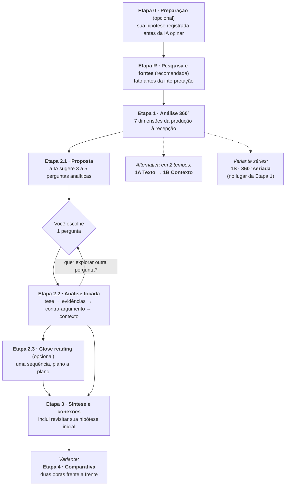

# Guia Completo do Fluxo

O **Fluxo** é um roteiro de prompts para dissecar filmes e séries com a ajuda
de uma IA (Claude, ChatGPT, Gemini etc.). Em vez de pedir "me fale sobre esse
filme" e receber um resumo genérico, o fluxo conduz uma análise progressiva
em três atos: uma **preparação** opcional que registra a sua hipótese, um
**mapa completo** da obra, um **mergulho profundo** nos pontos mais
interessantes e, por fim, uma **síntese** que conecta tudo e aponta os
próximos passos.

---

## 1. A lógica do fluxo

| Etapa | Papel no fluxo | Analogia |
| ----- | -------------- | -------- |
| **0 — Preparação** *(opcional)* | Registrar **sua** leitura antes da IA: hipótese, objetivo, nível | A anamnese |
| **R — Pesquisa e fontes** *(recomendada)* | Construir um dossiê verificável antes de interpretar: identidade, produção, recepção e controvérsias com fontes | O exame laboratorial |
| **1 — Análise 360°** | Mapear tudo: narrativa, imagem, som, montagem, contexto e legado | O raio-x |
| **1A + 1B** *(alternativa)* | O mesmo raio-x em dois tempos: primeiro o texto, depois o contexto | Raio-x em duas sessões |
| **1S — 360° seriada** *(variante)* | O raio-x traduzido para temporadas: arcos longos, piloto, cliffhangers e showrunner | O raio-x seriado |
| **2.1 — Proposta** | Identificar onde estão as questões mais ricas | Escolher onde operar |
| **2.2 — Análise focada** | Construir um argumento denso sobre uma única questão | A cirurgia |
| **2.3 — Close reading** *(opcional)* | Dissecar uma sequência plano a plano | A biópsia |
| **3 — Síntese** | Consolidar, julgar, conectar com outras obras e indicar leituras | A alta com recomendações |
| **4 — Comparativa** *(variante)* | Duas obras frente a frente sob um eixo: pares, diálogo e tabela-síntese | O exame comparativo |

**Regra de ouro:** rode as etapas **na mesma conversa**, em ordem. Cada
prompt foi escrito pressupondo o que a IA já disse antes ("Com base no que foi
levantado...", "Para consolidar todo o conhecimento gerado...").

### Antes do raio-x: a Etapa 0 (preparação)

A [Etapa 0](../prompts/etapa-00-preparacao.md) é opcional, mas muda a
qualidade de tudo o que vem depois. Nela, você declara **tipo da obra,
objetivo, nível e — principalmente — suas impressões e hipótese iniciais**.
A IA apenas: (1) confirma que identificou a obra certa (adeus, análise do
remake errado); (2) registra sua hipótese **sem julgá-la**; (3) sugere pontos
de atenção para assistir/reassistir; e (4) calibra a conversa ao seu nível.

Por que registrar a hipótese antes? Porque, sem isso, a leitura da IA
"ancora" a sua — no fim, você acha que sempre pensou daquele jeito. Com o
registro, a Etapa 3 vira um **antes/depois honesto** da sua própria
interpretação, que é o maior aprendizado do fluxo.

### A Etapa R: fato antes da interpretação

A [Etapa R](../prompts/etapa-00r-pesquisa-fontes.md) cria uma separação
deliberada entre **pesquisa** e **leitura crítica**. A dimensão 1 da Análise
360° é factual e, portanto, a mais vulnerável a datas, prêmios e equipes
inventadas. Antes dela, o dossiê pede: identidade inequívoca da obra, ficha
verificável, contexto de produção, recepção contemporânea e posterior,
controvérsias documentadas e uma lista de **afirmações incertas**. Se a IA
não tiver acesso à web, ela deve dizer isso e produzir apenas um mapa de
verificação — não transformar memória em referência.

A interface adiciona uma meia-máquina factual quando o navegador está
online: busca de títulos em **Wikipedia/Wikidata** e, para séries,
**TVMaze**. Ela nunca escolhe sozinha: você confirma o resultado, e os dados
viram um dossiê editável com URLs. Modelos com navegação entram na etapa
seguinte como camada de verificação, não como oráculo.

### Sessão guiada, Maestro e respostas

A Fase 5 organiza os templates em **trilhas**, em vez de expor todas as
etapas como se fossem equivalentes:

| Trilha | Ordem |
| ------ | ----- |
| Filme/longa padrão | 0 → R → 1 → 2.1 → 2.2 → 2.3 → 3 |
| Raio-x em dois tempos | 0 → R → 1A → 1B → 2.1 → 2.2 → 2.3 → 3 |
| Série/temporada | 0 → R → 1S → 2.1 → 2.2 → 2.3 → 3 |
| Comparativa | R → 4 |

Na web, cada sessão mostra o que está pronto, aguardando uma resposta ou
ainda bloqueado. Ao colar a resposta de cada etapa, o Fluxo guarda o texto,
extrai um resumo, cria um **pacote de contexto** para continuar em outra
conversa e reconhece as perguntas da Etapa 2.1 e sequências sugeridas para
a 2.3. O **Prompt Maestro** (`fluxo maestro`) é a alternativa de baixo
atrito: um único texto pede que a IA conduza a trilha inteira, mas ainda
pare nos pontos em que a decisão é sua — principalmente a pergunta da 2.1
e a sequência opcional da 2.3.

O projeto não usa uma chave de IA compartilhada. Você pode copiar e usar sua
própria ferramenta, ou optar por um executor sustentado pela sua conta/chave
(Puter ou BYOK) ou pelo seu aparelho (IA local do navegador). Isso mantém o
Fluxo gratuito para publicar e impede que uma cota pública acabe para todos.

---

## 2. Etapa 1 — as 7 dimensões da Análise 360°

A Etapa 1 ([template](../prompts/etapa-01-analise-360.md)) examina a obra sob
sete ângulos complementares:

| # | Dimensão | O que ela investiga | Pergunta-guia |
| - | -------- | ------------------- | ------------- |
| 1 | **Ficha Técnica e Contexto de Produção** | Dados essenciais + o mundo em que a obra nasceu (indústria, história, tecnologia, modelo de distribuição e quem detém a autoria) | "De onde essa obra veio?" |
| 2 | **Narrativa e Roteiro** | Estrutura real da obra (clássica ou não), gênero e convenções, focalização (quem vê/conta), temas e arcos de personagens | "Que história é contada e como ela é construída?" |
| 3 | **Linguagem Cinematográfica** | Fotografia, iluminação, paleta de cores, direção de arte, mise-en-scène, atuação e elenco | "Como a imagem conta a história?" |
| 4 | **Som** | Trilha sonora (score, leitmotivs), design de som, efeitos e o uso do silêncio | "O que os ouvidos percebem que os olhos não veem?" |
| 5 | **Montagem e Ritmo** | Velocidade dos cortes, planos longos, montagem paralela, elipses, flashbacks | "Como o tempo da história é manipulado?" |
| 6 | **Sociocultural e Representação** | Comentário social, ideologias da época, retrato de gênero/raça/classe etc. e o posicionamento do espectador (identificação e olhar) | "O que a obra diz sobre a sociedade — de propósito ou não?" |
| 7 | **Recepção e Impacto Cultural** | Crítica, público, prêmios, bilheteria, memes, influência em obras posteriores | "Que marca a obra deixou no mundo?" |

Juntas, elas impedem o erro mais comum de análises rápidas: olhar só para a
história e ignorar forma (imagem/som/montagem) e contexto (produção/sociedade).

**O que esperar da resposta:** um texto longo e estruturado. Se alguma dimensão
vier superficial, peça expansão pontual antes de seguir:
*"Aprofunde a dimensão 4 (Som) com exemplos de cenas específicas."*

### Alternativa em dois tempos: 1A (texto) + 1B (contexto)

Se a resposta da Etapa 1 vier truncada ou rala nas últimas dimensões — comum
em obras densas e em séries —, divida o raio-x em dois tempos, **no lugar**
da Etapa 1 (nunca junto dela):

- **[1A — O Texto](../prompts/etapa-01a-analise-texto.md)**: dimensões 2 a 5
  (narrativa, imagem, som, montagem), fechando com uma tabela-resumo parcial;
- **[1B — O Contexto](../prompts/etapa-01b-analise-contexto.md)**: dimensões
  1, 6 e 7 (produção, sociocultural, recepção), conectadas aos achados da 1A
  e com a **tabela-resumo completa das 7 dimensões** no fim.

A numeração das dimensões é a mesma nos dois caminhos — registro e etapas
seguintes funcionam igual.

### Variante para séries: a Etapa 1S

Para séries e temporadas, use a
**[Etapa 1S](../prompts/etapa-01s-analise-serie.md)** no lugar da Etapa 1: ela
mantém as 7 dimensões, mas traduz cada uma para a lógica seriada — arcos em
três níveis (série, temporada, episódio), piloto e *finale*, cliffhangers, o
papel do showrunner e o modelo de exibição (semanal × maratona) — e fecha com
a escolha de um episódio-síntese. Indique a temporada no título
(`Dark — Temporada 1 (2017)`) e siga para as Etapas 2.x/3 normalmente.
Detalhes na [seção 5](#5-adaptações-por-tipo-de-obra).

---

## 3. Etapa 2 — o aprofundamento interativo

### 2.1 Proposta ([template](../prompts/etapa-02.1-proposta-aprofundamento.md))

A IA relê o próprio mapa e propõe de 3 a 5 **perguntas analíticas** — não
perguntas de curiosidades ("qual o orçamento?"), mas questões interpretativas:
uma escolha de direção controversa, um símbolo recorrente, uma ambiguidade do
roteiro, uma tensão ética.

**Como escolher bem:**
- Prefira a pergunta que conecta **forma e sentido** (uma técnica + um tema).
- Perguntas com tensão ou paradoxo ("a obra critica X ou reproduz X?")
  rendem as análises mais ricas.
- Sem pressa de "esgotar": você pode rodar a 2.2 várias vezes, uma por pergunta.

### 2.2 Análise focada ([template](../prompts/etapa-02.2-analise-focada.md))

A resposta segue uma estrutura argumentativa clássica:

1. **Argumento central** — uma tese defensável, não um resumo;
2. **Evidências da obra** — cenas, diálogos e escolhas técnicas concretas, com
   minutagem ou episódio;
3. **Análise da evidência** — *como* aqueles elementos produzem o significado;
4. **Contra-argumento** — a objeção mais forte à tese e que evidência a
   derrubaria (a IA deve respondê-la ou ajustar a tese);
5. **Contexto e comparações** — diálogo com outras obras do diretor, gênero ou época.

**Dica avançada:** trate a 2.2 como um debate. O prompt já obriga a IA a
apresentar o contra-argumento mais forte à própria tese — conteste a resposta,
traga um contraexemplo seu e observe a tese se refinar (ou ruir). É aqui que a
análise deixa de ser descritiva e vira crítica de verdade.

### 2.3 Close reading — uma sequência sob a lupa (opcional)

A [Etapa 2.3](../prompts/etapa-02.3-close-reading.md) troca o panorama pelo
microscópio: você escolhe **uma sequência** (a abertura, o clímax, uma
virada) e a IA a disseca **plano a plano** — decupagem, mise-en-scène e som
por plano, ritmo interno e, por fim, o sentido que a forma constrói. É o
método clássico da análise fílmica: provar no detalhe aquilo que as etapas
anteriores afirmaram no geral, tratando a sequência como **microcosmo** da
obra inteira.

Dois cuidados: reassista à sequência antes (dedo no pause) e confira a
decupagem plano a plano — é aqui que as IAs mais inventam microdetalhes com
ar de certeza. Discordar com evidência ("na verdade é um plano aberto") faz
parte do exercício.

---

## 4. Etapa 3 — síntese, conexões e próximos passos

A etapa final ([template](../prompts/etapa-03-sintese-conexoes.md)) entrega:

1. **Síntese e relevância** — a essência da obra em um parágrafo;
2. **Pontos-chave** — os insights da *sua* conversa (não um resumo genérico);
3. **Balanço Crítico** — julgamento fundamentado, nos termos da própria obra:
   onde é exemplar, onde falha, para quem funciona;
4. **Diálogos audiovisuais** — 2 ou 3 obras para assistir em seguida e por quê;
5. **Perguntas para reflexão pessoal** — a obra espelhada em você e no
   presente, incluindo o confronto com a sua hipótese da Etapa 0;
6. **Crítica, teoria e bastidores** — fontes reais para continuar estudando
   (só as de existência confiável; o resto vem marcado "a confirmar");
7. **Ficha-resumo** — tese, achados, o antes/depois da sua leitura e a
   próxima obra em tópicos, pronta para salvar nas suas notas.

Guarde essa resposta: ela é o "relatório final" da análise. A CLI gera um
[`registro.md`](../templates/registro-de-analise.md) com espaço para colar e
organizar tudo isso.

---

## 5. Adaptações por tipo de obra

- **Filme:** uso direto. Inclua o ano no título para evitar confusão com
  remakes/homônimos: `Duna (2021)` vs. `Duna (1984)`.
- **Série (temporada):** rode o fluxo **por temporada**
  (`Dark — Temporada 1 (2017)`) e use a
  **[Etapa 1S](../prompts/etapa-01s-analise-serie.md)** no lugar da Etapa 1 —
  ela é desenhada para arcos longos, piloto, cliffhangers e showrunner; as
  Etapas 2.x e 3 seguem iguais.
- **Episódio específico:** funciona muito bem para episódios marcantes
  ("bottle episodes", finais). Use `Série — T1:E5 "Nome do episódio"` no título.
- **Documentário:** as dimensões se aplicam; a IA tende a adaptar "roteiro"
  para estrutura argumentativa e "personagens" para sujeitos retratados.
  Se quiser, acrescente ao fim do prompt da Etapa 1: *"Considere as
  especificidades do cinema documental (modos de Nichols) onde couber."*
- **Animação:** idem — a dimensão 3 costuma render muito (técnica, estilo,
  design). Opcional: *"Destaque as escolhas próprias da linguagem da animação."*
- **Duas obras em comparação (Etapa 4):** remakes e refilmagens, o mesmo
  diretor em épocas diferentes, o mesmo tema em países diferentes — use a
  **[Etapa 4 comparativa](../prompts/etapa-04-comparativa.md)**, que coloca
  as duas obras frente a frente sob um eixo e fecha com uma tabela-síntese.
  Funciona como conversa própria, em qualquer momento do seu estudo.

---

## 6. Boas práticas e limitações

✅ **Faça**
- Assista à obra **antes** (ou reassista às cenas citadas depois) — o fluxo
  aprofunda a experiência, não a substitui. E cuidado: há spoilers em tudo.
- Mantenha as 3 etapas na mesma conversa e na ordem.
- Peça exemplos de cenas sempre que uma afirmação soar genérica.
- Registre suas conclusões com suas palavras (use o `registro.md`).

⚠️ **Fique atento**
- **IAs inventam detalhes.** Cenas descritas com confiança podem não existir,
  e fontes citadas na Etapa 3 podem ser imprecisas. Os prompts já pedem que a
  IA marque incertezas com "(a confirmar)" — mesmo assim, confira o que for
  importante: trate a IA como parceira de debate, não como fonte primária.
- Obras muito recentes ou pouco conhecidas podem gerar análises mais fracas;
  nesses Casos, alimente a IA com sinopse/contexto logo após o prompt da Etapa 1.
- Se a resposta travar no meio por tamanho, responda apenas *"Continue de
  onde parou."*

---

## 7. Glossário rápido

| Termo | Significado breve |
| ----- | ----------------- |
| **Mise-en-scène** | Tudo o que está "posto em cena": cenários, figurinos, objetos, posição dos atores no quadro |
| **Leitmotiv** | Tema musical recorrente associado a personagem, lugar ou ideia |
| **Chiaroscuro** | Iluminação de forte contraste entre luz e sombra (do italiano "claro-escuro") |
| **High key / Low key** | Iluminação clara e uniforme (comédias, musicais) vs. escura e contrastada (noir, terror) |
| **Travelling** | Movimento em que a câmera se desloca (sobre trilhos, steady, drone...) |
| **Montagem paralela** | Alternância entre duas ou mais ações simultâneas em lugares diferentes |
| **Elipse** | Salto temporal: a narrativa "pula" um trecho de tempo |
| **Plano-sequência** | Cena longa filmada em uma única tomada contínua |
| **Score** | Trilha musical original composta para a obra (≠ músicas licenciadas) |
| **Arco de personagem** | A trajetória de transformação de um personagem ao longo da narrativa |
| **Showrunner** | Quem comanda criativamente uma série (roteiro, tom, arcos) — a figura autoral da ficção seriada |
| **Cliffhanger** | Gancho no fim do episódio que deixa uma situação-chave em suspenso para o próximo |
| **Binge-watching (maratona)** | Assistir a muitos episódios de uma vez — modelo de lançamento típico do streaming; opõe-se à exibição semanal |

---

## 8. Perguntas frequentes

**Preciso usar a CLI?**
Não. O jeito mais simples é a **interface web** (`index.html` na raiz do repo):
preencha os campos, copie o prompt pronto e cole na IA. Você também pode abrir
os arquivos em [`prompts/`](../prompts) e copiar o texto entre os marcadores
manualmente. A CLI automatiza o preenchimento e a organização dos arquivos
(veja o [README](../README.md)).

**Posso pular direto para a Etapa 2.2 com uma pergunta minha?**
Pode — ela funciona sozinha se você já conhece bem a obra. Mas o fluxo
completo costuma gerar perguntas melhores, porque a 2.1 nasce do mapa da
Etapa 1.

**Posso adaptar os prompts?**
Deve! Os templates são um ponto de partida. Ao editar, mantenha os marcadores
`<!-- INICIO DO PROMPT -->` / `<!-- FIM DO PROMPT -->` e o padrão de
placeholders `{{ASSIM}}` para a CLI continuar funcionando.

**Funciona com qualquer IA?**
Sim — os prompts são texto puro. Modelos com contexto maior lidam melhor com
as respostas longas da Etapa 1.

**A Etapa 0 é obrigatória?**
Não — mas é barata e muda o jogo: leva dois minutos, evita analisar a obra
errada (remakes/homônimos) e guarda a sua leitura "pura" para o confronto
da Etapa 3. Se já conhece a obra de cor e só quer o mapa, pule para a Etapa 1.

**Etapa 1 inteira ou 1A + 1B?**
A Etapa 1 é mais rápida e basta para a maioria dos Casos. Use os dois tempos
quando a obra for densa ou longa (séries!), quando a resposta única vier
truncada ou rala nas últimas dimensões, ou quando quiser o máximo de
profundidade por dimensão. Não use os dois caminhos na mesma análise.

**Para uma série, uso a Etapa 1 ou a 1S?**
A **1S**. Ela mantém as 7 dimensões, mas traduzidas para a lógica seriada
(arcos em 3 níveis, piloto, cliffhangers, showrunner, modelo de exibição) e
pede evidências por episódio (T1:E5) — um mapa bem mais útil para as etapas
seguintes. Rodou a Etapa 1 numa série? Sem drama: ela funciona; a 1S só
entrega mais.

**Qual modo de análise usar: padrão, iniciante ou acadêmico?**
O modo calibra o registro das respostas nas etapas de abertura (1, 1A, 1S e
4) — e, como a conversa é a mesma, a calibragem vale para o ciclo todo. Use
**iniciante** se quer cada termo técnico explicado ao aparecer,
**acadêmico** se quer rigor teórico com autores e conceitos nomeados, e
**padrão** no meio do caminho. Na CLI é a flag `--modo`; na interface web,
o seletor "Modo de análise".

**Sessão guiada ou Prompt Maestro?**
Use a **sessão guiada** quando quiser controle, salvar respostas, trocar de
IA no meio ou revisar a pergunta/sequência fora do chat. Use o **Maestro**
quando o atrito for o maior obstáculo: um único prompt abre a conversa e a
IA lidera as etapas, parando para as suas escolhas. A sessão guiada é o
caminho mais robusto; o Maestro, o mais fluido.

**O Fluxo paga ou fornece uma IA gratuita?**
Não — e isso é uma decisão de acessibilidade e sustentabilidade. O projeto é
estático e não mantém uma cota compartilhada que poderia esgotar. Você usa
sua IA atual pelo copiar/colar ou escolhe um executor opcional baseado na
sua conta, na sua chave ou no seu dispositivo.

**A busca de metadados substitui a Etapa R?**
Não. Wikipedia/Wikidata e TVMaze aceleram a identificação e a ficha básica,
mas o dossiê crítico continua precisando de verificação, fontes primárias e
registro de incertezas. Trate os metadados como matéria-prima com etiqueta,
não como verdade final.
