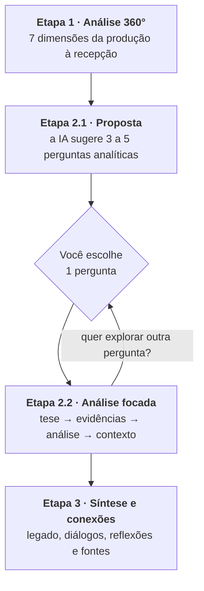

# Guia Completo do Fluxo

O **Fluxo** é um roteiro de prompts em 3 etapas para dissecar filmes e séries
com a ajuda de uma IA (Claude, ChatGPT, Gemini etc.). Em vez de pedir "me fale
sobre esse filme" e receber um resumo genérico, o fluxo conduz uma análise
progressiva: primeiro um **mapa completo** da obra, depois um **mergulho
profundo** no ponto mais interessante, e por fim uma **síntese** que conecta
tudo e aponta os próximos passos.

---

## 1. A lógica das 3 etapas

| Etapa | Papel no fluxo | Analogia |
| ----- | -------------- | -------- |
| **1 — Análise 360°** | Mapear tudo: narrativa, imagem, som, montagem, contexto e legado | O raio-x |
| **2.1 — Proposta** | Identificar onde estão as questões mais ricas | Escolher onde operar |
| **2.2 — Análise focada** | Construir um argumento denso sobre uma única questão | A cirurgia |
| **3 — Síntese** | Consolidar, conectar com outras obras e indicar leituras | A alta com recomendações |

**Regra de ouro:** rode as 3 etapas **na mesma conversa**, em ordem. Cada
prompt foi escrito pressupondo o que a IA já disse antes ("Com base no que foi
levantado...", "Para consolidar todo o conhecimento gerado...").

---

## 2. Etapa 1 — as 7 dimensões da Análise 360°

A Etapa 1 ([template](../prompts/etapa-01-analise-360.md)) examina a obra sob
sete ângulos complementares:

| # | Dimensão | O que ela investiga | Pergunta-guia |
| - | -------- | ------------------- | ------------- |
| 1 | **Ficha Técnica e Contexto de Produção** | Dados essenciais + o mundo em que a obra nasceu (indústria, história, tecnologia) | "De onde essa obra veio?" |
| 2 | **Narrativa e Roteiro** | Estrutura (três atos, jornada do herói, não-linear), temas e arcos de personagens | "Que história é contada e como ela é construída?" |
| 3 | **Linguagem Cinematográfica** | Fotografia, iluminação, paleta de cores, direção de arte, mise-en-scène | "Como a imagem conta a história?" |
| 4 | **Som** | Trilha sonora (score, leitmotivs), design de som, efeitos e o uso do silêncio | "O que os ouvidos percebem que os olhos não veem?" |
| 5 | **Montagem e Ritmo** | Velocidade dos cortes, planos longos, montagem paralela, elipses, flashbacks | "Como o tempo da história é manipulado?" |
| 6 | **Sociocultural e Representação** | Comentário social, ideologias da época, retrato de gênero/raça/classe etc. | "O que a obra diz sobre a sociedade — de propósito ou não?" |
| 7 | **Recepção e Impacto Cultural** | Crítica, público, prêmios, bilheteria, memes, influência em obras posteriores | "Que marca a obra deixou no mundo?" |

Juntas, elas impedem o erro mais comum de análises rápidas: olhar só para a
história e ignorar forma (imagem/som/montagem) e contexto (produção/sociedade).

**O que esperar da resposta:** um texto longo e estruturado. Se alguma dimensão
vier superficial, peça expansão pontual antes de seguir:
*"Aprofunde a dimensão 4 (Som) com exemplos de cenas específicas."*

---

## 3. Etapa 2 — o aprofundamento interativo

### 2.1 Proposta ([template](../prompts/etapa-02.1-proposta-aprofundamento.md))

A IA relê o próprio mapa e propõe de 3 a 5 **perguntas analíticas** — não
perguntas de curiosidades ("qual o orçamento?"), mas questões interpretativas:
uma escolha de direção controversa, um símbolo recorrente, uma ambiguidade do
roteiro, uma tensão ética.

**Como escolher bem:**
- Prefira a pergunta que conecta **forma e sentido** (uma técnica + um tema).
- Perguntas com tensão ou paradoxo ("a obra critica X ou reproduz X?")
  rendem as análises mais ricas.
- Sem pressa de "esgotar": você pode rodar a 2.2 várias vezes, uma por pergunta.

### 2.2 Análise focada ([template](../prompts/etapa-02.2-analise-focada.md))

A resposta segue uma estrutura argumentativa clássica:

1. **Argumento central** — uma tese defensável, não um resumo;
2. **Evidências da obra** — cenas, diálogos e escolhas técnicas concretas;
3. **Análise da evidência** — *como* aqueles elementos produzem o significado;
4. **Contexto e comparações** — diálogo com outras obras do diretor, gênero ou época.

**Dica avançada:** trate a 2.2 como um debate. Conteste a tese, apresente um
contraexemplo, peça que a IA critique o próprio argumento
(*"Qual é o contra-argumento mais forte à sua tese?"*). É aqui que a análise
deixa de ser descritiva e vira crítica de verdade.

---

## 4. Etapa 3 — síntese, conexões e próximos passos

A etapa final ([template](../prompts/etapa-03-sintese-conexoes.md)) entrega:

1. **Síntese e relevância** — a essência da obra em um parágrafo;
2. **Pontos-chave** — os insights da *sua* conversa (não um resumo genérico);
3. **Diálogos audiovisuais** — 2 ou 3 obras para assistir em seguida e por quê;
4. **Perguntas para reflexão pessoal** — a obra espelhada em você e no presente;
5. **Crítica, teoria e bastidores** — fontes reais para continuar estudando.

Guarde essa resposta: ela é o "relatório final" da análise. A CLI gera um
[`registro.md`](../templates/registro-de-analise.md) com espaço para colar e
organizar tudo isso.

---

## 5. Adaptações por tipo de obra

- **Filme:** uso direto. Inclua o ano no título para evitar confusão com
  remakes/homônimos: `Duna (2021)` vs. `Duna (1984)`.
- **Série (temporada):** rode o fluxo **por temporada** (`Dark — Temporada 1`).
  A dimensão 2 do template já pede arcos de temporada e de personagens.
- **Episódio específico:** funciona muito bem para episódios marcantes
  ("bottle episodes", finais). Use `Série — T1:E5 "Nome do episódio"` no título.
- **Documentário:** as dimensões se aplicam; a IA tende a adaptar "roteiro"
  para estrutura argumentativa e "personagens" para sujeitos retratados.
  Se quiser, acrescente ao fim do prompt da Etapa 1: *"Considere as
  especificidades do cinema documental (modos de Nichols) onde couber."*
- **Animação:** idem — a dimensão 3 costuma render muito (técnica, estilo,
  design). Opcional: *"Destaque as escolhas próprias da linguagem da animação."*

---

## 6. Boas práticas e limitações

✅ **Faça**
- Assista à obra **antes** (ou reassista às cenas citadas depois) — o fluxo
  aprofunda a experiência, não a substitui. E cuidado: há spoilers em tudo.
- Mantenha as 3 etapas na mesma conversa e na ordem.
- Peça exemplos de cenas sempre que uma afirmação soar genérica.
- Registre suas conclusões com suas palavras (use o `registro.md`).

⚠️ **Fique atento**
- **IAs inventam detalhes.** Cenas descritas com confiança podem não existir,
  e fontes citadas na Etapa 3 podem ser imprecisas. Confira o que for
  importante — trate a IA como parceira de debate, não como fonte primária.
- Obras muito recentes ou pouco conhecidas podem gerar análises mais fracas;
  nesses Casos, alimente a IA com sinopse/contexto logo após o prompt da Etapa 1.
- Se a resposta travar no meio por tamanho, responda apenas *"Continue de
  onde parou."*

---

## 7. Glossário rápido

| Termo | Significado breve |
| ----- | ----------------- |
| **Mise-en-scène** | Tudo o que está "posto em cena": cenários, figurinos, objetos, posição dos atores no quadro |
| **Leitmotiv** | Tema musical recorrente associado a personagem, lugar ou ideia |
| **Chiaroscuro** | Iluminação de forte contraste entre luz e sombra (do italiano "claro-escuro") |
| **High key / Low key** | Iluminação clara e uniforme (comédias, musicais) vs. escura e contrastada (noir, terror) |
| **Travelling** | Movimento em que a câmera se desloca (sobre trilhos, steady, drone...) |
| **Montagem paralela** | Alternância entre duas ou mais ações simultâneas em lugares diferentes |
| **Elipse** | Salto temporal: a narrativa "pula" um trecho de tempo |
| **Plano-sequência** | Cena longa filmada em uma única tomada contínua |
| **Score** | Trilha musical original composta para a obra (≠ músicas licenciadas) |
| **Arco de personagem** | A trajetória de transformação de um personagem ao longo da narrativa |

---

## 8. Perguntas frequentes

**Preciso usar a CLI?**
Não. Você pode abrir os arquivos em [`prompts/`](../prompts), copiar o texto
entre os marcadores e colar na IA. A CLI só automatiza o preenchimento dos
placeholders e a organização dos arquivos (veja o [README](../README.md)).

**Posso pular direto para a Etapa 2.2 com uma pergunta minha?**
Pode — ela funciona sozinha se você já conhece bem a obra. Mas o fluxo
completo costuma gerar perguntas melhores, porque a 2.1 nasce do mapa da
Etapa 1.

**Posso adaptar os prompts?**
Deve! Os templates são um ponto de partida. Ao editar, mantenha os marcadores
`<!-- INICIO DO PROMPT -->` / `<!-- FIM DO PROMPT -->` e o padrão de
placeholders `{{ASSIM}}` para a CLI continuar funcionando.

**Funciona com qualquer IA?**
Sim — os prompts são texto puro. Modelos com contexto maior lidam melhor com
as respostas longas da Etapa 1.
